 

## 👋 Hakkımda

Merhaba, ben **Fehmi**. 2022'den beri **Phexum**'da full-stack geliştiriciyim. Günlerim çoğunlukla
Java / Spring Boot servisleri, Angular ekranları ve Oracle sorguları arasında geçiyor; öncesinde
NestJS ile mikroservisler, React ve Vue ile arayüzler yazdım.

- 🏭 **Şu an:** kurumsal bir ERP'nin üretim odaklı modülleri — Spring Boot, Angular, Oracle
- 🤖 **Merak ettiğim:** AI ile geliştirme — Claude Code, MCP sunucuları, multi-agent akışlar
- 🎮 **Boş zamanlarda:** World of Warcraft addon'u yazıyorum → [**Hamal**](https://github.com/fehmialtinbas/Hamal)
- 💬 **Konuşalım:** backend mimarisi, Spring Boot, NestJS ya da veritabanı performansı

## 🧰 Teknolojiler

## 🚀 Çalıştığım Projeler

| | Proje | Teknolojiler | Ne yapıyor |
|:-:|---|---|---|
| 🏭 | **ERP Modülleri** | Java · Spring Boot · Angular · Oracle | Üretim planlama, takip ve kalite süreçleri için ERP modülleri |
| 🎓 | **EdTech Platform** | NestJS · PostgreSQL · Redis · RabbitMQ · MongoDB | Mikroservis altyapısı, ELK Stack entegrasyonu ve Elastic APM ile gözlemlenebilirlik |
| 🚚 | **Logistics Payment Tool** | TypeScript · React · PostgreSQL · Python | Fatura işleme ve ödeme optimizasyonu |
| ✈️ | **Airport Tracking** | Java · Spring Boot · MS SQL | Havalimanı operasyonları için iç araçlar |
| 🧬 | **AminoAcid App** | Node.js · Vue.js · MongoDB | NoSQL tabanlı iç uygulama |

## 🛠️ Açık Kaynak

<table>
<tr>
<td width="50%" valign="top">

### 🎒 [Hamal](https://github.com/fehmialtinbas/Hamal)

*Hamal: başkasının yükünü taşıyan.* WoW: Forever için bir addon: posta kutusunda banka
karakterinin adını yazarsın, çantandaki ona ait her şeyi bulur ve tek tıkla 12'şer eşyalık
postalarla yollar. Kütüphane yok, bağımlılık yok; sahte bir oyun istemcisine karşı 120+ test.

`Lua` · `GitHub Actions` · `luacheck`

</td>
<td width="50%" valign="top">

### 🐳 [ts_node_js_docker](https://github.com/fehmialtinbas/ts_node_js_docker)

Node.js + TypeScript servisini Docker Compose ile tek komutta ayağa kaldıran başlangıç
şablonu. Hazır imajı Docker Hub'da da var.

`TypeScript` · `Node.js` · `Docker`

</td>
</tr>
</table>

## 📬 İletişim

  
  

---

  <i>"Clean code always looks like it was written by someone who cares."</i> 
  <b>— Robert C. Martin</b>

